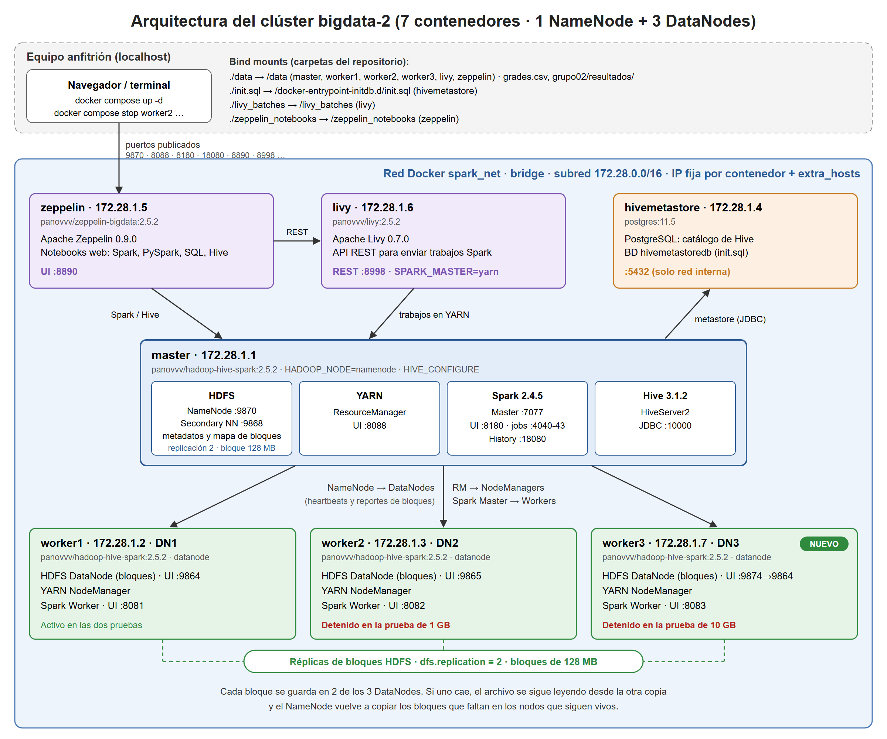

# bigdata-2

**LG14: investigación y despliegue de un repositorio Big Data con Docker**
**LG15: tolerancia a fallos y replicación de datos en HDFS**
Universidad Privada del Valle · **Grupo 02**

**Integrantes:** Antonio Santiago Sanchez Angulo, Bonny Alberto Crespo Romero y Mateo Alejandro Valeriano Sanchez

Este repositorio documenta el despliegue y la prueba de **[panovvv/bigdata-docker-compose](https://github.com/panovvv/bigdata-docker-compose)**. Ese proyecto levanta, con un solo `docker compose up -d`, un clúster Big Data con **Hadoop (HDFS + YARN), Hive, Spark, Livy y Zeppelin**.

Para la LG15 ampliamos el clúster a **1 NameNode + 3 DataNodes** (se agregó `worker3`) con factor de replicación 2. Después apagamos un DataNode mientras HDFS guardaba archivos de 1 GB y de 10 GB, para ver qué pasa con los datos. Los resultados están en la [sección 7](#7-lg15-tolerancia-a-fallos-y-replicación-en-hdfs).

---

## 1. Repositorio seleccionado

| Campo | Dato |
|---|---|
| Nombre | bigdata-docker-compose |
| Autor / organización | Vadim Panov ([panovvv](https://github.com/panovvv)) |
| URL | https://github.com/panovvv/bigdata-docker-compose |
| Fecha de creación | 30 de agosto de 2019 |
| Última actualización | 4 de febrero de 2021 |
| Estrellas / forks | 168 / 78 |
| Licencia | MIT |
| Descripción | Entorno Docker Compose que despliega un clúster con Hadoop (HDFS/YARN), Hive, Spark, Zeppelin y Livy para procesar y consultar datos distribuidos. |

**Objetivo del proyecto:** ofrecer un "patio de juegos" de Big Data que se enciende y se apaga con un solo comando. Reproduce en una computadora personal las herramientas de Amazon EMR sin instalar cada una por separado.

## 2. Tecnologías

| Aspecto | Detalle |
|---|---|
| Tecnología principal | Apache Hadoop 3.2.0 (HDFS + YARN) |
| Sobre Hadoop | Apache Hive 3.1.2, Apache Spark 2.4.5 (Scala 2.11) |
| Frameworks adicionales | Apache Zeppelin 0.9.0 (notebooks), Apache Livy 0.7.0 (API REST para Spark), HiveServer2, Spark History Server |
| Base de datos | PostgreSQL 11.5 (Hive Metastore) |
| Imágenes Docker | `panovvv/hadoop-hive-spark:2.5.2`, `panovvv/livy:2.5.2`, `panovvv/zeppelin-bigdata:2.5.2`, `postgres:11.5` |
| Sistema operativo base | Alpine Linux 3.10 (PostgreSQL usa la imagen oficial, basada en Debian) |
| Lenguajes | Java 8, Scala 2.11, Python 3.7 (PySpark), R 3.6 (SparkR), HiveQL/SQL. En el repositorio: YAML, SQL y Python |

## 3. Arquitectura

### Diagrama



Fuente editable: [`docs/arquitectura.svg`](docs/arquitectura.svg)

El clúster sigue el modelo **maestro / trabajadores**:
- `master` concentra los servicios que coordinan: NameNode, ResourceManager, Spark Master y HiveServer2.
- `worker1`, `worker2` y `worker3` guardan los datos (DataNode) y ejecutan las tareas (NodeManager y Spark Worker). `worker3` se agregó en la LG15 para tener 3 DataNodes.
- Alrededor hay tres servicios de apoyo: PostgreSQL para el catálogo de Hive, Livy (API REST) y Zeppelin (notebooks).

### Contenedores

Docker Compose crea **7 contenedores**, llamados `<carpeta>-<servicio>-1` (por ejemplo `bigdata-2-master-1`).

| Servicio | Imagen | IP (spark_net) | Función | Puertos publicados en el host |
|---|---|---|---|---|
| `hivemetastore` | postgres:11.5 | 172.28.1.4 | Base de datos del Hive Metastore (catálogo de bases de datos, tablas y esquemas de Hive) | ninguno (5432 solo dentro de la red) |
| `master` | panovvv/hadoop-hive-spark:2.5.2 | 172.28.1.1 | NameNode y Secondary NameNode (HDFS), ResourceManager (YARN), Spark Master, Spark History Server y HiveServer2 | 9870, 9868, 8088, 8180→8080, 4040-4043, 18080, 10000 |
| `worker1` | panovvv/hadoop-hive-spark:2.5.2 | 172.28.1.2 | DataNode (guarda los bloques), NodeManager y Spark Worker | 9864, 8081 |
| `worker2` | panovvv/hadoop-hive-spark:2.5.2 | 172.28.1.3 | Igual que worker1. Permite replicar los bloques con factor 2 | 9865, 8082 |
| `worker3` | panovvv/hadoop-hive-spark:2.5.2 | 172.28.1.7 | Tercer DataNode, agregado en la LG15. Permite que HDFS re-replique cuando cae otro nodo | 9874→9864, 8083 |
| `livy` | panovvv/livy:2.5.2 | 172.28.1.6 | API REST para enviar sesiones y trabajos Spark a YARN | 8998 |
| `zeppelin` | panovvv/zeppelin-bigdata:2.5.2 | 172.28.1.5 | Notebooks web para Spark (Scala, PySpark, SQL) y Hive | 8890 |

`master`, los tres workers y `livy` declaran `expose: 1-65535`: todos sus puertos son accesibles **dentro** de la red. Por ejemplo, el puerto 7077 del Spark Master, al que se conectan los workers, no se publica al host.

### Red

- Una sola red personalizada, `spark_net` (driver bridge, IPAM con subred `172.28.0.0/16`). Docker la nombra `<carpeta>_spark_net`.
- Cada contenedor tiene una **IP fija** (`ipv4_address`), de 172.28.1.1 a 172.28.1.7 (`worker3` usa la 172.28.1.7).
- Cada servicio declara `extra_hosts`, que agrega al `/etc/hosts` los nombres `master`, `worker1`, `worker2`, `worker3`, `hivemetastore`, `livy` y `zeppelin`. Es necesario porque Hadoop y Spark identifican a los nodos por nombre de host.

### Volúmenes

No hay volúmenes con nombre; solo **bind mounts** (carpetas del repositorio montadas en los contenedores):

| Origen (host) | Destino (contenedor) | Contenedores | Uso |
|---|---|---|---|
| `./data` | `/data` | master, worker1, worker2, worker3, livy, zeppelin | Datos de ejemplo (`grades.csv`, `ssn-address.tsv`), `batches/sample_batch.py` y los resultados de la LG15 (`grupo02/resultados/`) |
| `./init.sql` | `/docker-entrypoint-initdb.d/init.sql` | hivemetastore | PostgreSQL lo ejecuta en el primer arranque y crea la BD `hivemetastoredb` |
| `./livy_batches` | `/livy_batches` | livy | Trabajos batch para Livy |
| `./zeppelin_notebooks` | `/zeppelin_notebooks` | zeppelin | Notebooks de Zeppelin (persisten en el host) |

Consecuencia: los bloques y metadatos de HDFS y la base del metastore viven **dentro** de los contenedores. Se conservan con `docker compose stop`, pero **se pierden con `docker compose down`**.

### Dependencias entre servicios (`depends_on`)

```
hivemetastore ──► master, worker1, worker2, worker3 ──► livy ──► zeppelin
```

| Servicio | Arranca después de |
|---|---|
| `master`, `worker1`, `worker2`, `worker3` | `hivemetastore` |
| `livy` | `master`, `worker1`, `worker2` |
| `zeppelin` | `master`, `worker1`, `worker2`, `livy` |

`hivemetastore` además tiene un **healthcheck** (`pg_isready -U postgres` cada 10 s, 5 reintentos). `depends_on` solo controla el orden de arranque; no espera a que cada servicio esté listo.

### Variables de entorno

| Servicio | Variable | Valor | Para qué sirve |
|---|---|---|---|
| hivemetastore | `POSTGRES_PASSWORD` | `new_password` | Clave del usuario `postgres` |
| master | `HADOOP_NODE` | `namenode` | Hace que la imagen arranque como nodo maestro (NameNode, ResourceManager…) |
| master | `HIVE_CONFIGURE` | `yes, please` | Configura e inicia Hive (HiveServer2 + metastore en PostgreSQL) |
| master | `SPARK_MASTER_HOST`, `SPARK_LOCAL_IP` | `172.28.1.1` | IP en la que escucha el Spark Master |
| master / workers | `SPARK_LOCAL_HOSTNAME` | `master` / `worker1` / `worker2` / `worker3` | Nombre con el que Spark se anuncia |
| master / workers | `SPARK_PUBLIC_DNS` | `localhost` | Para que los enlaces de las UIs de Spark apunten a localhost |
| workers | `HADOOP_NODE` | `datanode` | Arranca DataNode y NodeManager |
| workers | `SPARK_MASTER_ADDRESS` | `spark://master:7077` | Master al que se registra el Spark Worker |
| workers | `SPARK_WORKER_PORT` / `SPARK_WORKER_WEBUI_PORT` | 8881/8081, 8882/8082 y 8883/8083 | Puertos distintos para cada worker |
| worker2 | `HADOOP_DATANODE_UI_PORT` | `9865` | Evita el choque con el 9864 de worker1 en el host |
| worker3 | (mapeo de puertos) | `9874:9864` | La UI del DataNode sigue en el 9864 dentro del contenedor y se publica en el 9874 del host |
| livy | `SPARK_MASTER` | `yarn` | Livy envía los trabajos Spark a YARN |
| livy | `LOCAL_DIR_WHITELIST` | `/data/batches/` | Carpeta desde la que Livy puede ejecutar scripts |
| livy | `ENABLE_HIVE_CONTEXT` | `false` | Sesiones Spark sin soporte de Hive |
| zeppelin | `ZEPPELIN_PORT` | `8890` | Puerto de la interfaz web |
| zeppelin | `ZEPPELIN_NOTEBOOK_DIR` | `/zeppelin_notebooks` | Dónde guarda los notebooks (bind mount) |

### Archivos de configuración

| Archivo | Descripción |
|---|---|
| [`docker-compose.yml`](docker-compose.yml) | Define los 7 servicios (incluido `worker3`), sus imágenes, puertos, variables de entorno, volúmenes, dependencias y la red `spark_net`. Usa `version: "3.7"`; Compose v2 avisa que ese atributo es obsoleto y lo ignora |
| [`init.sql`](init.sql) | `CREATE DATABASE "hivemetastoredb";`: crea la base que usa el Hive Metastore |
| [`data/batches/sample_batch.py`](data/batches/sample_batch.py) | Trabajo PySpark de ejemplo para enviar con Livy |
| `*-site.xml` (dentro de la imagen) | `core-site.xml`, `hdfs-site.xml`, `yarn-site.xml`, `hive-site.xml` y `spark-defaults.conf` no están en este repositorio: vienen dentro de la imagen `panovvv/hadoop-hive-spark`, y el script de arranque (`/entrypoint.sh`) aplica las variables de entorno de cada servicio |

## 4. Estructura del repositorio

```
bigdata-2/
├── docker-compose.yml     # Definición del clúster (7 servicios, 3 DataNodes, red spark_net)
├── init.sql               # Crea la BD hivemetastoredb en PostgreSQL
├── data/                  # Montado en /data
│   ├── grades.csv
│   ├── ssn-address.tsv
│   ├── batches/sample_batch.py
│   └── grupo02/resultados/          # Evidencias de la LG15
│       ├── 1GB_antes.txt            # fsck antes de apagar worker2
│       ├── 1GB_despues.txt          # fsck después de la re-replicación
│       ├── 1GB_linea_tiempo.txt     # cronología de la prueba de 1 GB
│       ├── 10GB_antes.txt           # fsck antes de apagar worker3
│       ├── 10GB_despues.txt         # fsck después de la re-replicación
│       └── 10GB_linea_tiempo.txt    # cronología de la prueba de 10 GB
└── docs/
    ├── arquitectura.png   # Diagrama de arquitectura
    └── arquitectura.svg   # Diagrama (fuente editable)
```

## 5. Instalación y ejecución

**Requisitos:** Docker Desktop con Docker Compose v2, unos 10 GB libres para las imágenes y **al menos 8 GB de RAM asignados a Docker**, como recomienda el autor del proyecto original. Para la prueba de 10 GB de la LG15 hacen falta unos **35 GB libres** más: el archivo ocupa 20 GB en HDFS por las 2 réplicas, y además se genera una vez en local.

```bash
# 1. Clonar e ingresar al repositorio
git clone https://github.com/MateoVal007/bigdata-2.git
cd bigdata-2

# 2. Identificar los archivos principales y revisar la configuración
ls -la
cat docker-compose.yml

# 3. Construir y ejecutar (descarga las imágenes la primera vez)
docker compose up -d

# 4. Verificar los contenedores (deben aparecer 7, incluido worker3)
docker ps

# 5. Entrar al nodo maestro para usar HDFS
docker compose exec master bash
#    En Git Bash para Windows: winpty docker compose exec master bash

# 6. Apagar el clúster (borra los datos de HDFS)
docker compose down
```

Interfaces web:

| Servicio | URL |
|---|---|
| HDFS NameNode | http://localhost:9870 |
| YARN ResourceManager | http://localhost:8088 |
| Spark Master | http://localhost:8180 |
| Spark History Server | http://localhost:18080 |
| DataNodes | http://localhost:9864 · http://localhost:9865 · http://localhost:9874 |
| Spark Workers | http://localhost:8081 · http://localhost:8082 · http://localhost:8083 |
| Zeppelin | http://localhost:8890 |
| Livy | http://localhost:8998 |

## 6. Prueba funcional (HDFS)

Esta prueba es de la LG14, cuando el clúster todavía tenía 2 DataNodes. Comandos ejecutados dentro del contenedor `master`:

```bash
hdfs dfsadmin -report                              # estado del clúster
hdfs dfsadmin -safemode get
hdfs dfs -mkdir -p /user/grupo/prueba              # 1. crear un directorio
hdfs dfs -ls /user/grupo
hdfs dfs -put /data/grades.csv /user/grupo/prueba/ # 2. cargar un archivo
hdfs dfs -ls /user/grupo/prueba                    # 3. consultar el archivo
hdfs dfs -cat /user/grupo/prueba/grades.csv | head
hdfs fsck /user/grupo/prueba -files -blocks -locations
```

| # | Objetivo | Resultado obtenido |
|---|---|---|
| 1 | Estado del clúster | 2 DataNodes vivos: worker1 (172.28.1.2) y worker2 (172.28.1.3). `Safe mode is OFF` |
| 2 | **Crear un directorio** | `drwxr-xr-x root supergroup 0 2026-10-04 21:09 /user/grupo/prueba` |
| 3 | **Cargar un archivo** | `grades.csv` copiado desde `/data` (bind mount de `./data`) a HDFS sin errores |
| 4 | **Consultar el archivo** | `-rw-r--r-- 2 root supergroup 764 /user/grupo/prueba/grades.csv`. `-cat` muestra la cabecera `Last name,First name,SSN,Test1,…,Grade` y los registros |
| 5 | Bloques y réplicas | 1 bloque, `replication=2`, réplicas en `172.28.1.2:9866` y `172.28.1.3:9866`. **Status: HEALTHY** |
| 6 | Interfaz web (http://localhost:9870) | worker1 y worker2 *In service*. `/user/grupo/prueba/grades.csv`: 764 B, Replication 2, Block Size 128 MB |

**Análisis**
- El NameNode solo guarda metadatos. El contenido está en los DataNodes, y `fsck` muestra el bloque copiado en **los dos workers**: el almacenamiento está distribuido entre contenedores distintos.
- El factor de replicación es 2, igual al número de DataNodes. Si un worker falla, el archivo sigue disponible.
- El archivo ocupa un solo bloque de 764 bytes. HDFS no reserva los 128 MB del tamaño de bloque.
- Los avisos `SLF4J: multiple bindings` y `Unable to load native-hadoop library` son informativos. El estado `unhealthy` que muestra `docker ps` en algunos contenedores viene del healthcheck de la imagen y no afectó a HDFS.

## 7. LG15: tolerancia a fallos y replicación en HDFS

**Objetivo:** comprobar con evidencias qué le pasa a un archivo guardado en HDFS cuando se cae uno de los DataNodes. Usamos un clúster de 1 NameNode y 3 DataNodes, factor de replicación 2, y archivos de 1 GB y 10 GB.

### 7.1 Configuración

| Componente | Requerido | Implementado |
|---|---|---|
| NameNode | 1 | `master` (172.28.1.1) |
| DataNodes | 3 | `worker1` (DN1, 172.28.1.2), `worker2` (DN2, 172.28.1.3) y `worker3` (DN3, 172.28.1.7) |
| Factor de replicación | ≥ 2 | `dfs.replication = 2` |
| Tamaño de bloque | – | `dfs.blocksize = 134217728` (128 MB) |
| Datasets | 1 GB y 10 GB | `dataset_grupo02_1GB` y `dataset_grupo02_10GB` |
| Pruebas de fallo | 2 | Se apagó worker2 con 1 GB y worker3 con 10 GB |

Para agregar `worker3` copiamos el servicio `worker2` en [`docker-compose.yml`](docker-compose.yml) y cambiamos tres cosas: la IP (172.28.1.7), los puertos de Spark (8883/8083) y la UI del DataNode, que se publica en el 9874 del host. También agregamos `worker3` a los `extra_hosts` de todos los servicios.

En HDFS usamos los directorios del grupo:

```
/grupo02/dataset_1GB/dataset_grupo02_1GB
/grupo02/dataset_10GB/dataset_grupo02_10GB
/grupo02/resultados/
/grupo02/evidencias/
```

### 7.2 Procedimiento

Dentro de `master` (`winpty docker compose exec master bash`):

```bash
# Verificar la configuración y los 3 DataNodes
hdfs getconf -confKey dfs.replication
hdfs getconf -confKey dfs.blocksize
hdfs dfsadmin -report | grep -E "Live datanodes|Dead datanodes|^Name:"

# Crear los directorios del grupo
hdfs dfs -mkdir -p /grupo02/dataset_1GB /grupo02/dataset_10GB /grupo02/resultados /grupo02/evidencias

# Generar y cargar el dataset (para el de 10 GB: count=10240 y carpeta dataset_10GB)
dd if=/dev/urandom of=/tmp/dataset_grupo02_1GB bs=1M count=1024
hdfs dfs -put /tmp/dataset_grupo02_1GB /grupo02/dataset_1GB/
rm /tmp/dataset_grupo02_1GB

# Estado inicial: bloques, réplicas y MD5 de referencia
hdfs fsck /grupo02/dataset_1GB -files -blocks -locations > /data/grupo02/resultados/1GB_antes.txt
hdfs dfs -cat /grupo02/dataset_1GB/dataset_grupo02_1GB | md5sum
```

Desde el host se apaga un DataNode:

```bash
docker compose stop worker2      # en la prueba de 10 GB: docker compose stop worker3
```

Durante la falla y después, otra vez dentro de `master`:

```bash
hdfs dfs -cat /grupo02/dataset_1GB/dataset_grupo02_1GB | md5sum   # ¿se sigue leyendo igual?
hdfs dfsadmin -report | grep -E "Live datanodes|Dead datanodes"    # ¿cuándo se marca como Dead?
hdfs fsck /grupo02/dataset_1GB | grep -E "Under-replicated|Status" # bloques subreplicados
hdfs fsck /grupo02/dataset_1GB -files -blocks -locations > /data/grupo02/resultados/1GB_despues.txt
```

En el host, el log del NameNode muestra el momento en que el nodo se da por perdido:

```bash
docker compose logs master | grep -i removeDeadDatanode
```

Antes de la segunda prueba volvimos a encender el nodo (`docker compose start worker2`) y esperamos a que hubiera otra vez 3 DataNodes vivos.

### 7.3 Prueba con el dataset de 1 GB (se apagó worker2)

- **Antes:** el archivo tenía 8 bloques de 128 MB con 2 réplicas cada uno. worker1 tenía 7 réplicas, worker2 tenía 3 y worker3 tenía 6. Estado HEALTHY.
- **Falla:** a las 23:14 UTC apagamos worker2, que tenía los bloques 2, 4 y 7. Todos tenían otra copia en un nodo vivo, así que el archivo se siguió leyendo y el MD5 salió igual al original (`0407df4651d944618f0d997188a084bd`).
- **Detección:** durante unos 10 minutos el NameNode siguió mostrando 3 nodos vivos. A las 23:25 worker2 apareció como Dead, y a las 23:30 el NameNode lo sacó del mapa de bloques. En ese momento aparecieron 3 bloques subreplicados.
- **Recuperación:** HDFS copió solo el bloque 2 a worker1 y los bloques 4 y 7 a worker3. A las 23:32 ya no quedaban bloques subreplicados. Al final worker1 y worker3 tenían los 8 bloques cada uno.

Evidencias: [`1GB_antes.txt`](data/grupo02/resultados/1GB_antes.txt) · [`1GB_despues.txt`](data/grupo02/resultados/1GB_despues.txt) · [`1GB_linea_tiempo.txt`](data/grupo02/resultados/1GB_linea_tiempo.txt)

### 7.4 Prueba con el dataset de 10 GB (se apagó worker3)

- **Antes:** 80 bloques de 128 MB con 2 réplicas cada uno. El reparto fue parejo: worker1 tenía 54 réplicas, worker2 tenía 51 y worker3 tenía 55. Estado HEALTHY.
- **Falla:** a las 00:11 UTC apagamos worker3, que tenía 55 de los 80 bloques. El archivo se siguió leyendo completo y el MD5 coincidió (`92e78edb5c572176b2ac46d48d432a6a`).
- **Detección:** igual que antes, unos 10 minutos sin cambios. A las 00:22 worker3 apareció como Dead, y a las 00:26 el NameNode lo quitó del mapa. En ese momento había 55 bloques subreplicados.
- **Recuperación:** los 26 bloques que estaban en worker2 y worker3 se copiaron a worker1, y los 29 que estaban en worker1 y worker3 se copiaron a worker2. Copió casi 7 GB en unos 2 minutos y medio. Al final worker1 y worker2 tenían los 80 bloques cada uno.

Evidencias: [`10GB_antes.txt`](data/grupo02/resultados/10GB_antes.txt) · [`10GB_despues.txt`](data/grupo02/resultados/10GB_despues.txt) · [`10GB_linea_tiempo.txt`](data/grupo02/resultados/10GB_linea_tiempo.txt)

### 7.5 Comparación

| Característica | Dataset 1 GB | Dataset 10 GB |
|---|---|---|
| Tamaño | 1 GB | 10 GB |
| Número de bloques | 8 bloques de 128 MB | 80 bloques de 128 MB |
| Factor de replicación | 2 | 2 |
| DataNode afectado | worker2 (DN2) | worker3 (DN3) |
| Bloques afectados | 3 de 8 (37,5 %) | 55 de 80 (68,75 %) |
| Bloques disponibles después de la falla | Los 8, con al menos una copia | Los 80, con al menos una copia |
| ¿Archivo accesible? | Sí, el MD5 coincidió con el original | Sí, el MD5 coincidió con el original |
| ¿Hubo bloques subreplicados? | Sí, 3 bloques | Sí, 55 bloques |
| Tiempo de recuperación | Unos 18 minutos (la copia tomó menos de 3) | Unos 17 minutos (la copia tomó unos 2 y medio) |
| Nuevas réplicas | Bloque 2 en worker1; bloques 4 y 7 en worker3 | 26 bloques en worker1 y 29 en worker2 (casi 7 GB) |

### 7.6 Conclusiones

- **El archivo nunca dejó de estar disponible.** Como cada bloque está en dos nodos distintos, el cliente simplemente lee la copia que sigue viva.
- **El que coordina todo es el NameNode.** Se da cuenta de la caída cuando dejan de llegar los heartbeats, espera unos 10 minutos para no confundirla con un corte breve y después ordena copiar los bloques que se quedaron con una sola réplica.
- **Factor 2 no quiere decir dos copias completas del archivo.** HDFS replica por bloques, así que el archivo queda repartido entre los tres nodos y ninguno lo tiene entero.
- **Disponible no es lo mismo que replicado.** Durante unos 17 o 18 minutos el archivo se podía leer pero sin cumplir el factor 2. Si en ese rato hubiera caído otro nodo, sí se habrían perdido datos.
- **La mayor parte del tiempo de recuperación es espera, no copia.** Por eso con 10 GB, aunque se movió mucho más volumen, el tiempo total fue parecido: la copia se hizo en paralelo desde los dos nodos que quedaban.

## 8. Comparación con big-data-europe/docker-hadoop

| Característica | [docker-hadoop](https://github.com/big-data-europe/docker-hadoop) | bigdata-docker-compose (seleccionado) |
|---|---|---|
| Tecnología principal | Hadoop 3.2.1: HDFS, YARN, MapReduce | Hadoop 3.2.0 (HDFS, YARN) + Hive 3.1.2 + Spark 2.4.5 |
| Docker | Una imagen por rol (`bde2020/hadoop-*`), Debian 9 | Una imagen para todos los roles + Livy + Zeppelin + Postgres, Alpine 3.10 |
| Docker Compose | Sí: 5 servicios, red por defecto, config. en `hadoop.env` | Sí: 7 servicios (con worker3), red `spark_net` con IP fijas, config. en `environment` |
| Número de contenedores | 5 | 7 (6 originales + worker3) |
| Almacenamiento distribuido | HDFS: 1 NameNode + 1 DataNode | HDFS: 1 NameNode + 3 DataNodes, replicación 2 |
| Procesamiento distribuido | YARN + MapReduce | YARN + Spark (3 workers), Hive SQL, Livy |
| Interfaces web | Solo 9870 publicada | Todas publicadas en localhost |
| Persistencia | Volúmenes con nombre para HDFS | Solo bind mounts; HDFS se pierde con `down` |
| Complejidad de instalación | Baja | Media (imágenes pesadas, unos 8 GB de RAM) |
| Documentación | README breve | README extenso con pruebas por componente |
| Caso de uso | Aprender el núcleo de Hadoop | Laboratorio completo tipo Amazon EMR |

## 9. Créditos

- Proyecto original: [panovvv/bigdata-docker-compose](https://github.com/panovvv/bigdata-docker-compose), de Vadim Panov (licencia MIT). `docker-compose.yml`, `init.sql` y `data/` provienen de ese repositorio. El grupo agregó el servicio `worker3` y los resultados de `data/grupo02/`.
- Referencia de comparación: [big-data-europe/docker-hadoop](https://github.com/big-data-europe/docker-hadoop).
